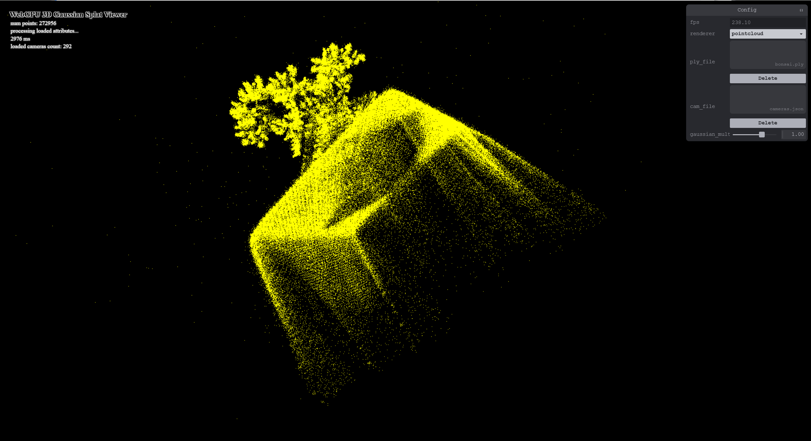
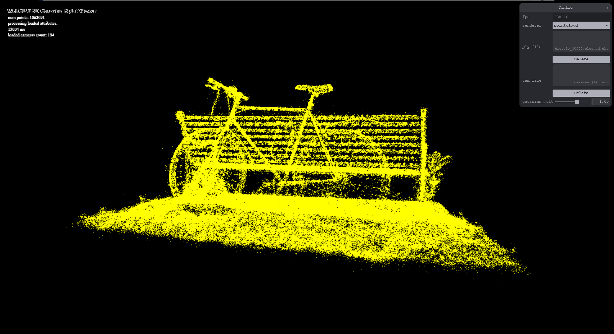
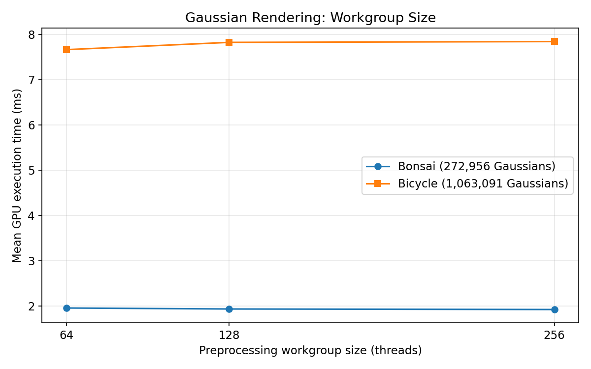
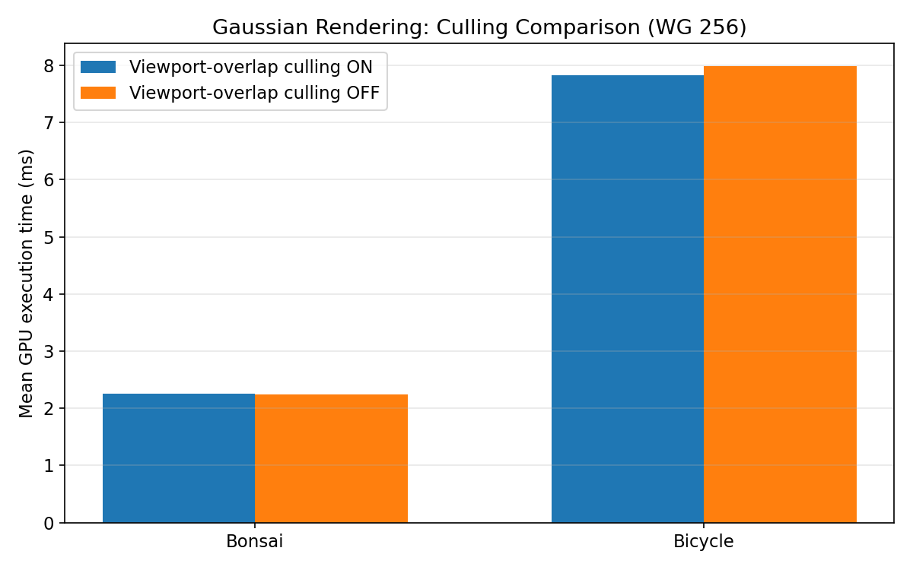
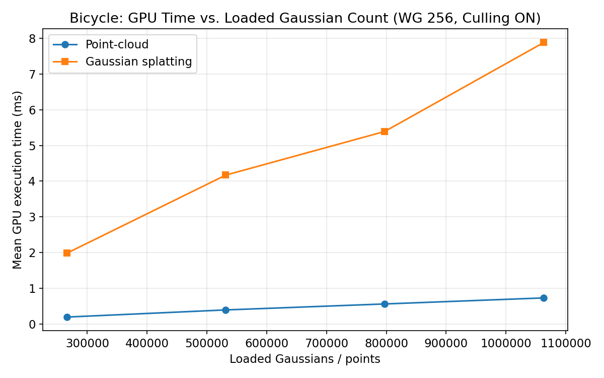
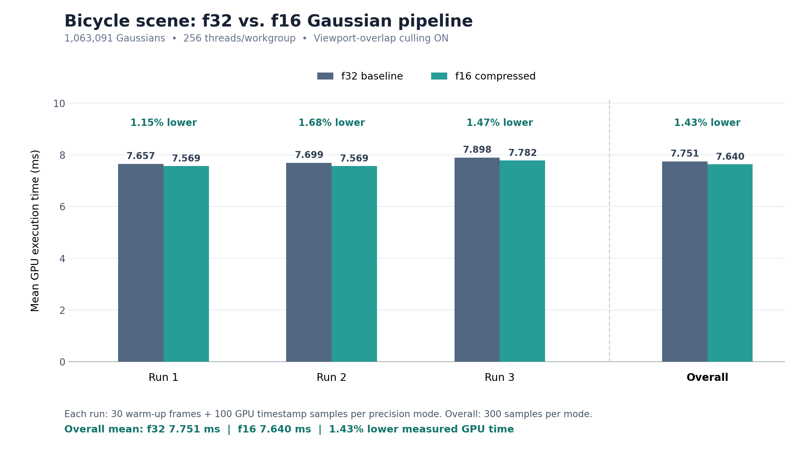

# Project5-WebGPU-Gaussian-Splat-Viewer

**University of Pennsylvania, CIS 565: GPU Programming and Architecture, Project 5**

* Ethan Yang
* Tested on: Google Chrome 155, Windows 11, NVIDIA GeForce RTX 5060 Laptop GPU (8 GB VRAM)

### Live Demo

[WebGPU Gaussian Splat Viewer](https://eyang72004.github.io/Project5-WebGPU-Gaussian-Splat-Viewer/)

### Demo Video/GIF

[Bonsai Demo](images/07_bonsai_HQ.mp4)

[Bicycle Demo](images/08_bicycle_HQ.mp4)

### Project Overview

This project implements a WebGPU-based 3D Gaussian Splatting viewer that supports both point-cloud rendering and Gaussian splat rendering. The point-cloud renderer provides a baseline for comparing rendering quality and GPU performance, while the Gaussian renderer reconstructs scenes using projected Gaussian splats.

The viewer supports loading PLY scene files, importing camera presets from JSON files, interactive camera navigation, and switching between rendering modes. The Gaussian rendering pipeline uses GPU compute shaders to preprocess Gaussian attributes and perform depth sorting before rendering the resulting splats.

A major focus of this project is performance analysis. I implemented GPU timestamp benchmarking to compare point-cloud and Gaussian rendering, evaluate different compute shader workgroup sizes, measure the effect of frustum culling, and investigate how performance scales with the number of Gaussians.

### Implemented Features

- **Point-Cloud Renderer:** Renders the loaded PLY scene as points, providing a baseline for comparison with Gaussian splatting.
- **Gaussian Splat Renderer:** Renders projected 3D Gaussians using their positions, scales, rotations, opacities, and color information.
- **GPU Preprocessing:** Uses WebGPU compute shaders to prepare Gaussian attributes for screen-space rendering.
- **GPU Depth Sorting:** Sorts Gaussian splats according to depth for ordered rendering.
- **Frustum Culling:** Performs visibility checks during preprocessing, including configurable viewport-overlap rejection.
- **Configurable Compute Workgroup Size:** Supports workgroup sizes of 64, 128, and 256 threads for preprocessing experiments.
- **Gaussian Count Selection:** Supports loading 25%, 50%, 75%, or 100% of a PLY scene to evaluate performance scaling.
- **Camera Controls:** Supports interactive camera navigation and camera presets loaded from JSON files.
- **GPU Performance Benchmarking:** Uses WebGPU timestamp queries to measure GPU execution time and export individual measurements as CSV files.
- **Half-Precision Gaussian Preprocessing (+10 Extra Credit):** Implements an optional `shader-f16` preprocessing path with selected native half-precision arithmetic and a compressed 32-byte intermediate splat representation, compared with the 48-byte baseline.
- **Precision Benchmarking:** Automatically compares f32 and f16 rendering using GPU timestamp queries and exports per-sample CSV results.

### Implementation Details

#### Point-Cloud Rendering

The point-cloud renderer provides a straightforward baseline for displaying the input scene. Each point represents a position from the loaded PLY data, with its associated color information.

Compared with Gaussian splatting, point-cloud rendering requires substantially less processing per point. However, points do not represent the projected spatial extent of a Gaussian, which can result in a less continuous scene reconstruction.

The point-cloud renderer is also used as a performance baseline in the benchmarking experiments.

#### Gaussian Splat Rendering

The Gaussian renderer processes the input scene through three main stages:

1. **Gaussian Preprocessing:** Gaussian attributes are transformed and projected into screen space. Visibility and validity checks are applied, and the resulting attributes are prepared for rendering.
2. **Depth Sorting:** Gaussians are sorted according to depth to support ordered splat rendering.
3. **Splat Rendering:** The projected Gaussians are rendered using their screen-space shapes, opacities, and color information to reconstruct the scene.

Gaussian splatting represents a scene using spatially extended primitives rather than isolated points. This enables smoother and more continuous reconstruction, but requires additional GPU work for preprocessing, sorting, and rendering.

#### Frustum Culling

The Gaussian preprocessing pipeline includes checks that reject Gaussians which should not contribute to the rendered view.

For performance experiments, I implemented a toggle for the viewport-overlap culling check. This allows the effect of that particular culling operation to be measured.

Importantly, disabling this toggle does not disable all preprocessing visibility or validity checks. Behind-camera, depth-range, and invalid-projection checks remain active.

#### Configurable Gaussian Count

To evaluate how GPU execution time changes with scene size, I extended the PLY loading process to support four Gaussian-count configurations:

- 25% of the original Gaussians
- 50% of the original Gaussians
- 75% of the original Gaussians
- 100% of the original Gaussians

The loader computes the requested number of Gaussians from the original PLY vertex count and allocates GPU buffers accordingly.

The fractional configurations use the first N Gaussians in the PLY file rather than random sampling. Therefore, smaller configurations may have different spatial distributions from the complete scene.

#### Half-Precision Gaussian Preprocessing (Extra Credit)

I implemented a half-precision Gaussian preprocessing path using WebGPU's `shader-f16` feature. The original f32 pipeline is preserved as a baseline, and the viewer provides a precision selector to switch between the two implementations.

The f16 preprocessing shader uses native half-precision arithmetic for selected operations, including opacity sigmoid evaluation and exponentiation of Gaussian scales. Projection, covariance calculations, and other geometry-sensitive operations remain in f32 to avoid introducing unnecessary numerical error.

The optimized pipeline also compresses the intermediate splat representation from 48 bytes to 32 bytes per Gaussian. Projected centers and inverse covariance coefficients remain in f32, while opacity and RGB color are packed into four 16-bit floating-point values using `pack2x16float`. A separate rendering shader decodes these values using `unpack2x16float`.

The compressed representation reduces the intermediate splat stride by 33.3%. Both the original and compressed buffers are currently allocated to support runtime switching, so this does not imply a 33.3% reduction in total GPU memory usage.

The f16 pipeline is available only when the GPU supports `shader-f16`; otherwise, the original f32 implementation remains available.

The viewer starts in the f32 baseline mode. The f16 path is opt-in through the precision selector, which is only offered when the device exposes `shader-f16`.

#### GPU Performance Benchmarking

I implemented GPU timestamp-based benchmarking to evaluate rendering performance.

Each benchmark configuration uses 30 warm-up frames followed by 100 measured GPU samples. The benchmark reports mean GPU execution time and exports individual samples to CSV files.

For the Gaussian renderer, each sample is the interval between a timestamp written at the beginning of the preprocessing compute pass and a timestamp written at the end of the splat render pass. Every Gaussian timing therefore includes **preprocessing, depth sorting, and rendering** together, not any one stage in isolation.

Four benchmark modes were implemented:

- **Workgroup-size comparison:** Measures Gaussian rendering performance with 64, 128, and 256 preprocessing threads per workgroup.
- **Frustum-culling comparison:** Measures Gaussian rendering performance with viewport-overlap culling enabled and disabled.
- **Renderer comparison:** Measures point-cloud and Gaussian rendering under the same loaded scene configuration.
- **Precision comparison:** Measures the original f32 Gaussian pipeline against the compressed f16 implementation, using identical workgroup-size and frustum-culling settings.

The renderer comparison was also used to evaluate performance at different Gaussian counts.

All reported GPU timings were collected using Google Chrome 155 on Windows 11 with an NVIDIA GeForce RTX 5060 Laptop GPU.

### Performance Analysis

The following experiments investigate the performance characteristics of the implemented WebGPU Gaussian splatting pipeline.

For each configuration, I collected 100 GPU timestamp samples after 30 warm-up frames. The tables report the arithmetic mean GPU execution time.

GPU execution time is distinct from the frame rate displayed by the viewer. The results measure GPU work captured by the benchmark rather than complete end-to-end application latency.

#### Benchmark Records and Consistency

**Precision used in Experiments 1–4: f32.** The CSV files for Experiments 1–4 were all exported on October 24, 2026 between 13:57 and 19:15. The f16 preprocessing shader (`preprocess_f16.wgsl`) was not created until 19:55 that day, and the compressed f16 render shader (`gaussian_f16.wgsl`) until 22:27, so the f16 pipeline did not exist when those experiments were run. Only Experiment 5 compares f16 against f32.

**The same configuration appears with different times in different experiments.** The Bonsai Gaussian renderer at 256 threads with viewport-overlap culling enabled is reported three times:

| Experiment | Reported Time | CSV Exported (Oct 24, 2026) |
|---|---:|---|
| 2. Workgroup size (256 threads) | 1.922 ms | 13:57 |
| 3. Frustum culling (ON) | 2.252 ms | 15:42 |
| 1. Renderer comparison (Gaussian) | 1.834 ms | 18:08 |

These are three separate benchmark sessions recorded hours apart, not repeated trials under controlled conditions. The preprocessing shader source was also modified between the first and second sessions, so the code was not necessarily identical across them. The camera view used in each session was not recorded, and the cause of the roughly 23% spread could not be verified. **Numbers should only be compared within a single experiment**, where all configurations were measured back-to-back in the same session. Comparisons across experiments are not meaningful.

Similarly, the Bicycle row in Experiment 1 and the 100% row in Experiment 4 are the same measurement (exported together at 19:15).

#### Visual Comparison

The following screenshots compare point-cloud and Gaussian splat rendering for the Bonsai and Bicycle scenes.

**Bonsai — Point-Cloud Rendering**

**Bonsai — Gaussian Splat Rendering**

**Bicycle — Point-Cloud Rendering**

**Bicycle — Gaussian Splat Rendering**

#### 1. Point-Cloud Rendering vs. Gaussian Splat Rendering

The first experiment compares the performance of the point-cloud renderer and the Gaussian splat renderer.

| Scene | Gaussian Count | Point-Cloud GPU Time | Gaussian GPU Time | Gaussian / Point-Cloud |
|---|---:|---:|---:|---:|
| Bonsai | 272,956 | 0.193 ms | 1.834 ms | 9.52x |
| Bicycle | 1,063,091 | 0.732 ms | 7.878 ms | 10.76x |

For both scenes, point-cloud rendering was substantially faster than Gaussian splatting.

On Bonsai, Gaussian rendering required approximately 9.52 times as much GPU time as point-cloud rendering. On Bicycle, Gaussian rendering required approximately 10.76 times as much GPU time.

This difference reflects the additional operations performed by the Gaussian renderer. Whereas point-cloud rendering draws relatively simple point primitives, Gaussian splatting requires preprocessing Gaussian attributes, sorting splats by depth, and rendering their projected screen-space coverage.

These additional operations allow Gaussian splatting to represent the projected size and shape of each primitive, producing a more continuous reconstruction than isolated points.

The results demonstrate a tradeoff between the richer representation provided by Gaussian splatting and its higher computational cost.

#### 2. Effect of Compute Shader Workgroup Size

The second experiment investigates whether increasing the Gaussian preprocessing workgroup size improves performance.

Three workgroup sizes were evaluated: 64, 128, and 256 threads.

| Workgroup Size | Bonsai GPU Time | Bicycle GPU Time |
|---|---:|---:|
| 64 | 1.956 ms | 7.662 ms |
| 128 | 1.934 ms | 7.823 ms |
| 256 | 1.922 ms | 7.841 ms |

For Bonsai, increasing the workgroup size from 64 to 256 threads slightly reduced GPU execution time, from 1.956 ms to 1.922 ms (about 1.7%).

For Bicycle, the 64-thread configuration was the fastest: 7.662 ms, compared with 7.841 ms at 256 threads (about 2.3% slower at 256).

Neither scene shows a consistent trend, and the spread is small. There are three reasons to be cautious about reading much into it:

- **Only part of the timed work depends on workgroup size.** The workgroup size only changes the preprocessing dispatch. Depth sorting and splat rendering, which are also inside the timed interval, run the same way regardless. Any change in preprocessing cost is therefore diluted by the stages that did not change.
- **The differences are similar in size to run-to-run variation.** Each configuration was measured once (100 samples). In Experiment 5, three repeated f32 runs of the same Bicycle configuration ranged from 7.657 ms to 7.898 ms, a spread of about 3%. The workgroup-size differences here are smaller than that.
- **Preprocessing is one thread per Gaussian with no shared memory or barriers.** Because of this, workgroup size mostly changes how threads are grouped for scheduling, not the amount of work. Larger workgroups mean fewer workgroups to dispatch. Smaller ones give the scheduler finer-grained units to distribute. Neither effect is expected to be large for this kernel.

These results do not establish an optimal workgroup size for this GPU. They are consistent with workgroup size having little effect on total frame GPU time for this pipeline.

#### 3. Effect of Frustum Culling

The third experiment evaluates the performance impact of the implemented viewport-overlap culling operation.

Both configurations used a preprocessing workgroup size of 256 threads.

| Scene | Culling ON | Culling OFF | Performance Difference |
|---|---:|---:|---|
| Bonsai | 2.252 ms | 2.241 ms | OFF approximately 0.5% faster |
| Bicycle | 7.828 ms | 7.983 ms | ON approximately 1.9% faster |

For Bonsai, enabling viewport-overlap culling did not improve performance. The culling-disabled configuration was approximately 0.5% faster.

For Bicycle, enabling culling reduced GPU execution time by approximately 1.9%.

**What the toggle changes.** The toggle only controls the viewport-overlap test, which checks whether a Gaussian's three-sigma footprint overlaps the screen. Behind-camera, near/far depth-range, and invalid-covariance rejection stay active in both configurations. With culling OFF, a Gaussian that is in front of the camera but entirely off-screen is still:

1. given a spherical-harmonics color evaluation and written to the splat buffer during preprocessing,
2. appended to the sort list and sorted by depth, and
3. drawn as an instanced quad, running the vertex shader for its six vertices.

With culling ON, these Gaussians are dropped before step 1's color evaluation, so they cost nothing in sorting or rendering.

**Culling savings vs. hardware clipping.** Even with culling OFF, off-screen quads produce essentially no fragments, because the GPU's fixed-function clipping and rasterization discard geometry outside the viewport. Fragment shading and alpha blending, usually the most expensive part of splatting, are therefore *not* where culling saves time. The actual savings are limited to SH color evaluation, sorting work, and per-instance vertex processing for off-screen Gaussians. Against that, every Gaussian pays for the overlap test. This explains why the measured effect is small in both directions.

**Why the scenes may differ.** How much culling helps depends on how many Gaussians in front of the camera are off-screen, which depends on the scene and camera view. A plausible explanation is that the tested Bicycle view had more off-screen Gaussians than the Bonsai view. However, I did not record visible-Gaussian counts for either configuration, so this cannot be confirmed from these measurements. The Bonsai difference (0.011 ms) is also well within the run-to-run variation discussed above. It should be read as "no measurable effect," not as culling making Bonsai slower.

#### 4. Effect of Gaussian Count

The fourth experiment investigates how GPU execution time changes as the number of Gaussians increases.

I used the Bicycle scene and loaded 25%, 50%, 75%, and 100% of its original Gaussian data.

Each configuration used a 256-thread preprocessing workgroup size with viewport-overlap culling enabled.

| Gaussian Fraction | Gaussian Count | Point-Cloud GPU Time | Gaussian GPU Time |
|---|---:|---:|---:|
| 25% | 265,772 | 0.196 ms | 1.982 ms |
| 50% | 531,545 | 0.396 ms | 4.169 ms |
| 75% | 797,318 | 0.563 ms | 5.390 ms |
| 100% | 1,063,091 | 0.732 ms | 7.878 ms |

Increasing the Gaussian count from 265,772 to 1,063,091, approximately a fourfold increase, increased Gaussian GPU execution time from 1.982 ms to 7.878 ms.

This corresponds to approximately a 3.98x increase in execution time.

Point-cloud rendering time also increased with scene size, from 0.196 ms at 25% to 0.732 ms at 100%.

The measurements indicate approximately linear scaling with Gaussian count over the tested range.

As the number of Gaussians increases, more primitives must be preprocessed, sorted, and potentially rendered. These additional operations increase the total GPU workload.

However, the measurements do not establish a formal asymptotic complexity bound for the rendering pipeline.

Additionally, the reduced-size datasets were created by selecting the first N Gaussians in the PLY file rather than randomly sampling the full scene. Consequently, changes in spatial distribution and visible coverage may also influence the measured GPU times.

#### 5. Half-Precision Gaussian Preprocessing (Extra Credit)

The fifth experiment evaluates whether half-precision preprocessing and compressed intermediate splat storage improve GPU performance relative to the original f32 pipeline.

I used the Bicycle scene with all 1,063,091 Gaussians, a preprocessing workgroup size of 256 threads, and viewport-overlap frustum culling enabled. Both precision modes used the same scene and camera configuration.

Each benchmark run consisted of 30 warm-up frames followed by 100 GPU timestamp samples per precision mode. I repeated the experiment three times, collecting 300 samples per mode.

| Run | f32 Mean GPU Time | f16 Mean GPU Time | GPU Time Reduction |
|---|---:|---:|---:|
| 1 | 7.657 ms | 7.569 ms | 1.15% |
| 2 | 7.699 ms | 7.569 ms | 1.68% |
| 3 | 7.898 ms | 7.782 ms | 1.47% |
| **Overall** | **7.751 ms** | **7.640 ms** | **1.43%** |

Across the three runs, the compressed f16 implementation reduced mean GPU execution time from approximately 7.751 ms to 7.640 ms, corresponding to a 1.43% reduction in measured GPU time.

The f16 implementation was faster in all three runs, although the improvement was relatively small. The results suggest that half-precision preprocessing and compressed splat storage can provide a modest performance benefit for the tested scene and GPU.

The optimization reduces the intermediate splat representation from 48 bytes to 32 bytes per Gaussian, a 33.3% reduction in per-splat storage. However, both representations are allocated to support runtime precision switching, and the measured timing includes preprocessing, sorting, and rendering rather than preprocessing alone.

Therefore, the results do not establish that preprocessing itself is 1.43% faster or that total GPU memory usage is reduced by 33.3%. Additional experiments would be required to isolate the individual contributions of half-precision arithmetic and compressed memory accesses.

The results also reflect three sequential f32-then-f16 benchmark runs on one GPU. Although the improvement was consistent across these runs, GPU clock variation, temperature, and benchmark order may influence the measured differences.

#### Performance Analysis Summary

The five experiments demonstrate several characteristics of the WebGPU Gaussian splatting pipeline:

- Point-cloud rendering is substantially faster than Gaussian splatting because it avoids much of the additional preprocessing, sorting, and splat rendering work.
- Increasing compute shader workgroup size does not consistently improve performance across scenes.
- The benefit of viewport-overlap culling depends on the scene and the amount of work eliminated.
- GPU execution time increases approximately proportionally with Gaussian count over the tested range.
- The compressed f16 Gaussian pipeline achieved a modest reduction in measured GPU execution time across three benchmark runs, while reducing intermediate splat storage from 48 to 32 bytes per Gaussian.

Overall, these experiments show that Gaussian rendering performance depends on both the number of primitives and the characteristics of the GPU workload. They also demonstrate why GPU optimizations should be evaluated empirically rather than assumed to improve performance in every scene.

### Credits

- [Vite](https://vitejs.dev/)
- [tweakpane](https://tweakpane.github.io/docs//v3/monitor-bindings/)
- [stats.js](https://github.com/mrdoob/stats.js)
- [wgpu-matrix](https://github.com/greggman/wgpu-matrix)
- Special Thanks to: Shrek Shao (Google WebGPU team) & [Differential Guassian Renderer](https://github.com/graphdeco-inria/diff-gaussian-rasterization)
